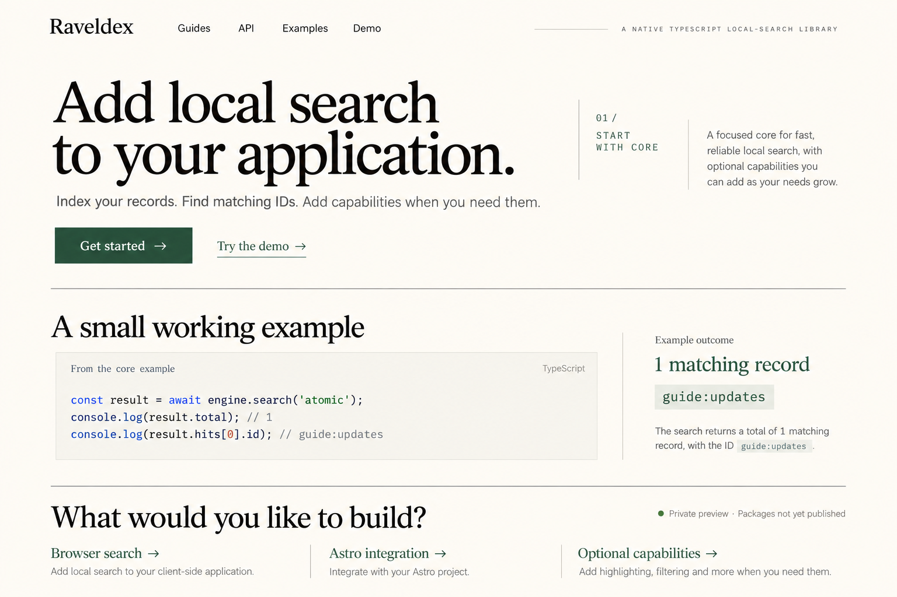
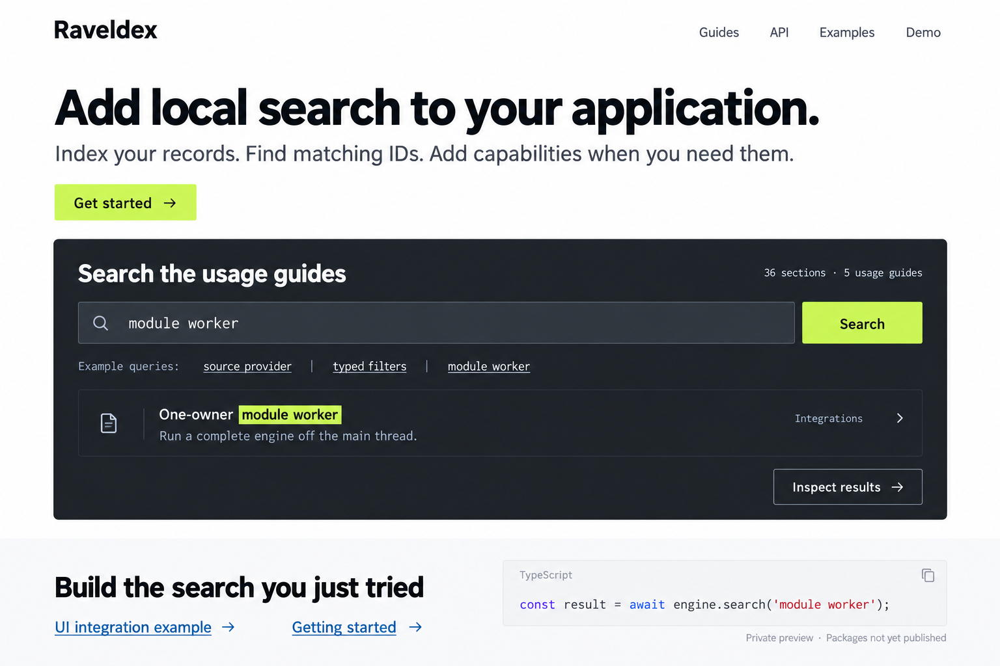
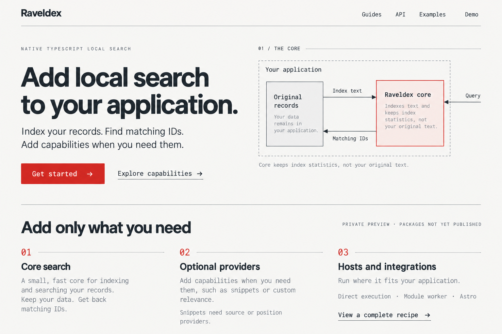

# Raveldex design previews

Generated 30 October 2026 using the built-in imagegen tool in `ui-mockup` mode. These are static visual concepts, not implemented pages or tested interfaces. Small supporting copy is illustrative; use the repository's actual examples and contracts during implementation.

Based on the [design directions report](../SITE_DESIGN_DIRECTIONS_2026-10-30.md). The owner subsequently selected Search Workbench for implementation on 30 October 2026; see the [implementation contract](../../specs/SITE_WORKBENCH.md). Each preview uses the same principal message and navigation so the visual approaches can be compared.

## Field Guide



### Generation prompt

```text
Use case: ui-mockup.
Asset type: high-fidelity desktop homepage design preview, one standalone raster image.
Primary request: visualize the FIELD GUIDE creative direction for Raveldex, a native TypeScript local-search library. This is a polished, feasible website design screenshot, flat and front-facing, not a photo of a device. Landscape canvas, approximately 3:2. Show a complete compelling opening and the beginning of a second section at readable scale.
Visual thesis: an exceptionally well-edited technical field guide. Warm ivory background, nearly black ink, deep forest-green functional accent, quiet hairline rules. Refined large editorial serif headlines, clear modern sans-serif body text, practical monospace code. Broad breathing room, intentional asymmetry, careful baseline alignment. Flat crisp surfaces, almost no shadows or rounded cards.
Content and composition: understated Raveldex wordmark at top; navigation "Guides", "API", "Examples", "Demo". Large headline exactly "Add local search to your application." Short text exactly "Index your records. Find matching IDs. Add capabilities when you need them." Prominent forest-green "Get started" button and secondary "Try the demo" link. An elegant indexed side annotation "01 / START WITH CORE" supports the editorial concept, without crowding reading.
Below, a well-composed worked example headed "A small working example". Present a light code panel and a compact aligned explanatory margin note, not a generic three-card feature grid. Readable code fragment:
const result = await engine.search('atomic');
console.log(result.total); // 1
console.log(result.hits[0].id); // guide:updates
Label it "From the core example". Pair it with the actual example outcome "1 matching record" and "guide:updates". A fine rule leads into "What would you like to build?" with concise task links "Browser search", "Astro integration", "Optional capabilities". Small accurate status note "Private preview · Packages not yet published".
Constraints: Raveldex spelled R-a-v-e-l-d-e-x. Render the specified main text accurately. This should feel like a desirable real developer documentation site, not a generic SaaS theme. Avoid photography, literal books, paper grain, botanical illustrations, decorative handwriting, fake testimonials, logos of customers, benchmark claims, npm install command, pricing, 3D objects, gradient blobs, browser chrome, mockup frames and watermark. Keep strong text contrast and readable interface text. This is the warm editorial option; do not introduce dark console styling or architecture diagrams.
```

## Search Workbench



### Generation prompt

```text
Use case: ui-mockup.
Asset type: high-fidelity desktop homepage design preview, one standalone raster image.
Primary request: visualize the SEARCH WORKBENCH creative direction for Raveldex, a native TypeScript local-search library. A polished, feasible website design screenshot, flat and front-facing, not a photo of a device. Landscape canvas approximately 3:2, showing the opening and a meaningful second section at readable scale.
Visual thesis: a beautifully precise working search instrument. Crisp modern sans-serif typography, paper-white reading surfaces, one substantial graphite search demonstration surface, electric chartreuse used sparingly for query highlights and the primary control. Understated monospace captions identify example queries and code. Tight alignment, purposeful spacing and squared-off restrained shapes, no floating futuristic effects.
Content and composition: Raveldex wordmark and navigation "Guides", "API", "Examples", "Demo". Large confident headline exactly "Add local search to your application." Short text exactly "Index your records. Find matching IDs. Add capabilities when you need them." Visible "Get started" link and a demo-led main composition.
The dominant visual is an inviting charcoal search workbench, labeled "Search the usage guides". Place a real-looking labeled query input containing "module worker" with a conspicuous "Search" button. Beneath it show restrained sample-query links "source provider", "typed filters", "module worker". Present one illustrative result with title "One-owner module worker", supporting text "Run a complete engine off the main thread.", a discreet "Integrations" category and a right-facing link affordance. Highlight "module worker" in the result using chartreuse with dark readable text. Small exact corpus label "36 sections · 5 usage guides". Provide a secondary "Inspect results" action, not an open analytics dashboard.
The lower light section connects use to learning: heading "Build the search you just tried", with two direct links "UI integration example" and "Getting started". Include a tiny readable code fragment "const result = await engine.search('module worker');" as supporting material only. Small accurate note "Private preview · Packages not yet published".
Constraints: Raveldex spelled R-a-v-e-l-d-e-x. Render specified main text accurately. This is an illustrative static design preview, so do not invent response-time measurements, result totals, performance guarantees or public availability. Avoid feature-card grids, pricing, testimonials, generic dashboard statistics, particles, glowing neon, gaming aesthetics, gradients, full-page terminal, photography, 3D objects, device frames, browser chrome and watermark. Preserve generous white reading space around the concentrated dark demonstration. Clear contrast and readable controls. Distinctly demo-led, not editorial serif or blueprint-diagram design.
```

## Assembly Manual



### Generation prompt

```text
Use case: ui-mockup.
Asset type: high-fidelity desktop homepage design preview, one standalone raster image.
Primary request: visualize the ASSEMBLY MANUAL creative direction for Raveldex, a native TypeScript local-search library. A polished, feasible website design screenshot, flat and front-facing, not a photo of a device. Landscape canvas approximately 3:2, showing an engaging opening and the next section at readable scale.
Visual thesis: an elegant engineering manual explaining a small system clearly. Cool pale neutral background, charcoal text, fine gray rules, one vermilion signal accent. Strong restrained grotesk headlines, technical monospace captions, measured whitespace, rigorous alignment and purposeful numbering. No decorative grid covering the whole page, no cartoon construction imagery.
Content and composition: Raveldex wordmark with navigation "Guides", "API", "Examples", "Demo". Large headline exactly "Add local search to your application." Short text exactly "Index your records. Find matching IDs. Add capabilities when you need them." Clearly visible vermilion "Get started" action and secondary "Explore capabilities" link.
Beside or directly below the introduction, create a beautifully legible technical relationship diagram integrated into the page rather than a dashboard card. Give it caption "01 / THE CORE". Accurate diagram logic: an outer group "Your application" contains an item "Original records" and a distinct item "Raveldex core". An arrow labelled "Index text" leads from Original records to Raveldex core. A query line labelled "Query" enters core. A return arrow labelled "Matching IDs" points back toward application-owned records or a simple "Display data" application item. Caption "Core keeps index statistics, not your original text." Original records must clearly remain application-owned, not inside core.
Below a strong horizontal rule, a section headed "Add only what you need" uses an ordered, spacious capability list rather than a tile grid: "01  Core search", "02  Optional providers", "03  Hosts and integrations". Under Optional providers show the factual short note "Snippets need source or position providers." Under Hosts and integrations show "Direct execution · Module worker · Astro". Include a small "View a complete recipe" link. Small accurate status note "Private preview · Packages not yet published".
Constraints: Raveldex spelled R-a-v-e-l-d-e-x. Main text and diagram labels must be accurate and legible. Diagram should be simple enough to read immediately. Do not imply that core retains original records, that optional features are automatic, or that every integration is required. Avoid made-up install commands, performance numbers, pricing, testimonials, customer logos, gear icons, circuit boards, literal construction, 3D exploded objects, blueprint wallpaper, dark terminal surfaces, gradient blobs, browser chrome, device frames and watermark. Accessible-looking contrast. This is the precise modular architecture option, distinct from warm editorial Field Guide and dark demo Workbench.
```


